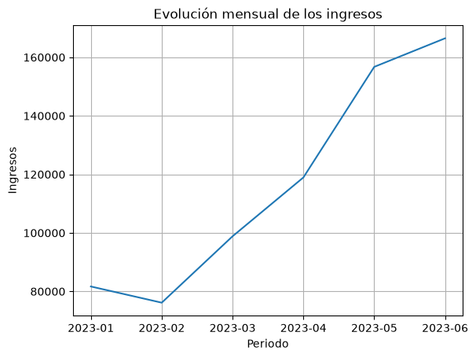
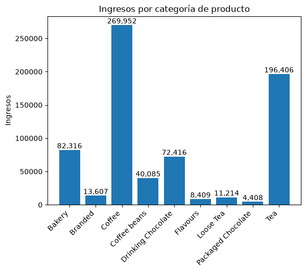
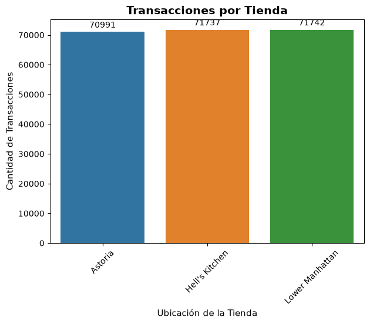
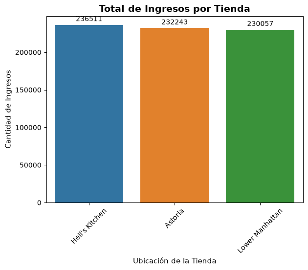
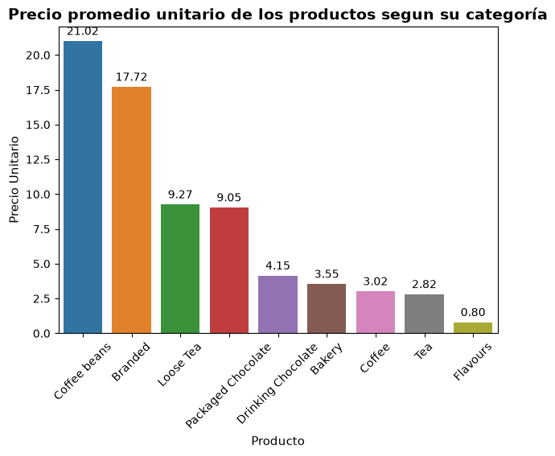
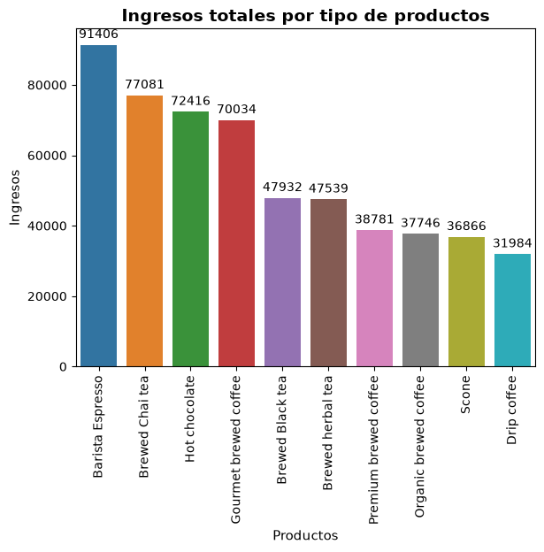

# ☕ Coffee Shop Sales Analysis

## 📌 Descripción

Análisis exploratorio de las ventas de una cafetería ficticia utilizando datos de transacciones correspondientes al período comprendido entre enero y junio de 2023.

El proyecto busca identificar los productos, categorías, tiendas y períodos de tiempo que tienen mayor participación en las ventas, con el objetivo de obtener insights que permitan comprender el comportamiento comercial de la cafetería.

## 🎯 Objetivo

Analizar el comportamiento de las ventas de la cafetería para identificar patrones, productos y categorías relevantes, así como oportunidades de análisis que puedan contribuir a la toma de decisiones comerciales.

## ❓ Pregunta de negocio

> **¿Qué factores influyen en las ventas de la cafetería y qué oportunidades existen para mejorar su rendimiento?**

## 📊 Dataset

El dataset utilizado corresponde a **Coffee Shop Sales**, publicado por **Maven Analytics**.

Contiene **149,116 registros** y **11 variables** relacionadas con las transacciones de la cafetería.

Entre las principales variables se encuentran:

* Fecha y hora de la transacción.
* Cantidad de productos vendidos.
* Tienda y ubicación.
* Producto y categoría.
* Precio unitario.

👉 [Ver y descargar el dataset](https://mavenanalytics.io/data-playground/coffee-shop-sales)

## 🛠️ Tecnologías utilizadas

* **Python**
* **Pandas**
* **NumPy**
* **Matplotlib**
* **Seaborn**
* **Jupyter Notebook**
* **Git / GitHub**

## 🔎 Proceso de análisis

El análisis se desarrolló siguiendo las siguientes etapas:

### 1. Exploración de los datos

* Dimensiones del dataset.
* Tipos de datos.
* Valores nulos.
* Registros duplicados.
* Estadística descriptiva.

### 2. Preparación y transformación

* Creación de un dataset de trabajo.
* Cálculo de ingresos por transacción.
* Creación de variables temporales.
* Preparación de métricas para el análisis.

### 3. Análisis exploratorio

* Análisis de productos.
* Análisis por categorías.
* Comparación entre tiendas.
* Análisis temporal.
* Relación entre precio y volumen de ventas.

### 4. Visualización

* Evolución mensual de los ingresos.
* Ingresos por categoría y producto.
* Comparación de tiendas.
* Análisis del precio promedio por categoría.
* Productos con mayor generación de ingresos.

### 5. Insights y recomendaciones

A partir de los resultados obtenidos se identificaron patrones y hallazgos relevantes sobre la distribución de los ingresos, el comportamiento de los productos y el desempeño de las tiendas.

## 📈 Principales hallazgos

* Los **10 productos principales representan aproximadamente el 78.96% de los ingresos totales**, evidenciando una alta concentración de los ingresos en un grupo reducido de productos.

* Las categorías **Coffee y Tea** presentan los mayores niveles de ingresos entre las categorías analizadas.

* **Barista Espresso** es el producto con mayor generación de ingresos, con aproximadamente **91,406**, mientras que **Brewed Chai tea** registra el mayor volumen de unidades vendidas, con **26,250 unidades**.

* Los ingresos presentan una **tendencia general creciente** durante el período analizado, aunque se observa una disminución durante febrero.

* Se identificó una **relación negativa moderada** entre el precio promedio y las unidades vendidas (`r = -0.5868`). Esta relación representa una asociación observada en los datos y no permite establecer causalidad.

## 💡 Insights de negocio

Los ingresos de la cafetería están concentrados principalmente en un grupo reducido de productos. Los diez productos principales representan aproximadamente el **78.96% de los ingresos totales**, por lo que tienen una participación importante en el desempeño económico observado durante el período analizado.

Además, las categorías **Coffee y Tea** presentan los mayores niveles de ingresos, lo que las convierte en segmentos relevantes para analizar el comportamiento comercial de la cafetería.

La diferencia entre los productos con mayor volumen de ventas y aquellos con mayor generación de ingresos demuestra que **vender más unidades no necesariamente implica generar mayores ingresos**. Por esta razón, ambas métricas deben analizarse conjuntamente.

## 💡 Recomendaciones

* **Monitorear la disponibilidad** de los productos con mayor contribución a los ingresos para reducir el riesgo de interrupciones en las ventas.

* **Analizar oportunidades comerciales** dentro de las categorías Coffee y Tea, debido a su participación en los ingresos.

* Evaluar estrategias diferenciadas para productos con **alto volumen de ventas** y productos con **alta generación de ingresos**, midiendo posteriormente su impacto.

* Analizar el comportamiento de los productos de mayor precio para determinar si existen oportunidades de ajustar su estrategia comercial, teniendo en cuenta que la relación observada entre precio y volumen de ventas no implica causalidad.

## 📊 Visualizaciones

### Evolución mensual de los ingresos



Muestra la evolución de los ingresos durante el período analizado y permite identificar la tendencia temporal de las ventas.

### Ingresos por categoría y producto



Permite comparar la contribución de las diferentes categorías y productos a los ingresos totales.

### Transacciones por tienda



Compara el número de transacciones realizadas en cada una de las tiendas analizadas.

### Ingresos por tienda



Permite comparar la generación de ingresos entre las diferentes ubicaciones de la cafetería.

### Precio promedio por categoría



Muestra las diferencias en el precio promedio de los productos entre las distintas categorías.

### Top 10 productos por ingresos




Presenta los diez productos con mayor generación de ingresos y permite identificar aquellos que tienen una mayor contribución al desempeño económico de la cafetería.

## ⚠️ Limitaciones del análisis

* El dataset comprende únicamente el período de **enero a junio de 2023**, por lo que no permite analizar un año completo ni determinar patrones de estacionalidad anual.
* No contiene información sobre **costos**, por lo que el análisis se enfoca en ingresos y no en rentabilidad.
* No dispone de información detallada sobre los clientes.
* No incluye variables como inventario, promociones, clima o eventos externos.
* Las asociaciones encontradas entre variables no permiten establecer relaciones causales.

## 📂 Estructura del proyecto

```text
coffee-shop-sales-analysis/
│
├── data/
│   ├── raw/
│   │   └── Coffee Shop Sales.xlsx
│   └── processed/
│
├── images/
│   ├── ingresos_mensuales.png
│   ├── ingresos_categoria_producto.png
│   ├── transacciones_tienda.png
│   ├── ingresos_tienda.png
│   ├── precio_promedio_categoria.png
│   └── top10_ingreso_producto.png
│
├── notebooks/
│   └── coffee-shop-sales-analysis.ipynb
│
├── .gitignore
├── README.md
└── requirements.txt
```

## 🚀 Cómo ejecutar el proyecto

### 1. Clonar el repositorio

```bash
git clone <URL_DEL_REPOSITORIO>
```

### 2. Instalar las dependencias

```bash
pip install -r requirements.txt
```

### 3. Abrir el notebook

Ejecutar:

```bash
jupyter notebook
```

y abrir el archivo:

```text
notebooks/coffee-shop-sales-analysis.ipynb
```

## 👤 Autor

**Angel Junior Gonzalez Zuleta**

Ingeniero Electrónico | Data Analyst en formación

Este proyecto forma parte de mi portafolio de análisis de datos y demuestra el uso de Python para la exploración, transformación, análisis y visualización de datos orientados a la toma de decisiones.
